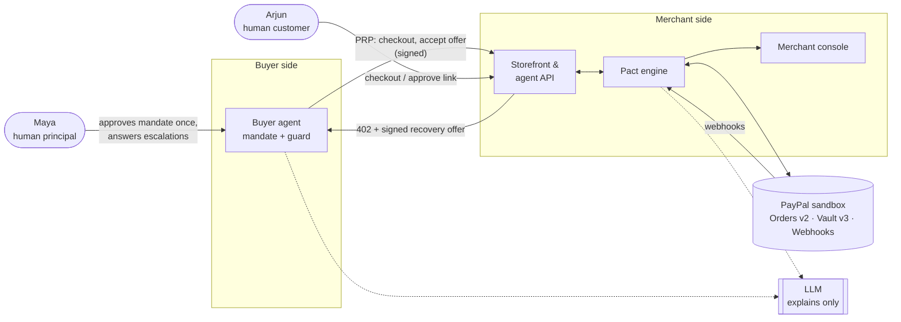
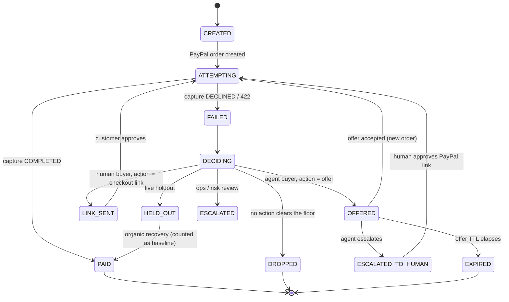
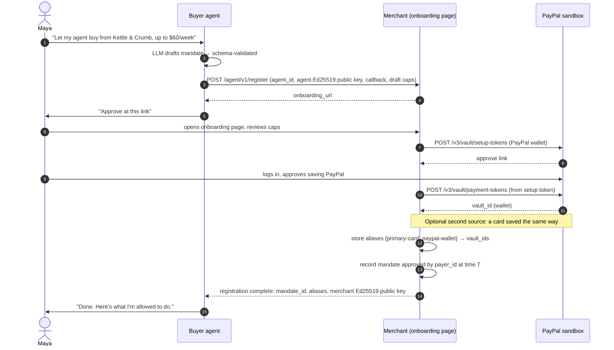
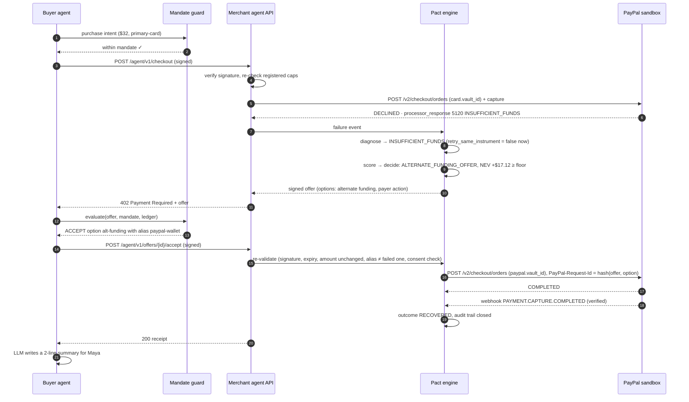
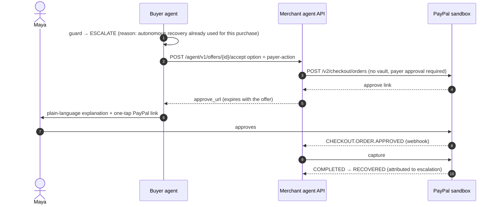

# 01 · System design

## 1. Actors

| Actor | Who / what | Trust level |
|---|---|---|
| **Human principal** | The person who delegates purchases (demo persona: *Maya*) | Authorises mandates; final say on escalations |
| **Buyer agent** | Software acting for Maya — shops, pays, handles recovery offers | Bound by Maya's mandate; untrusted by the merchant |
| **Human customer** | An ordinary customer with a saved payment method (demo: *Arjun*) | Normal checkout |
| **Merchant** | A fictional small online shop (demo: *Kettle & Crumb*, coffee & supplies) | Runs the Pact engine |
| **Pact engine** | Merchant-side diagnosis, decision and recovery | Bound by the merchant's policy |
| **PayPal (sandbox)** | Orders v2, Vault v3, webhooks | Source of truth for money movement |
| **LLM** | Any OpenAI-compatible model | Writes and explains; has no authority |

## 2. Context diagram

## 3. Lifecycle of a payment intent

Every purchase is a **payment intent** on the merchant side. Attempts are PayPal
orders made against it. Recovery never creates a second intent.

Terminal outcome for measurement: `RECOVERED` (paid after a Pact action),
`ORGANIC` (paid with no Pact action, including holdout), `LOST`.

## 4. Flow A — onboarding (once per human, per merchant)

Purpose: Maya saves funding sources with the merchant through PayPal and
approves the limits her agent may use. This gives the agent something it can pay
with **without** a human on the page, and gives the merchant evidence the
mandate was approved by the PayPal account holder.

The buyer agent **never sees a vault_id**. It only knows aliases.

**Two layers of consent, kept distinct.** Maya's PayPal approval of the setup
token is PayPal's consent for *this merchant* to charge the saved method later.
Her mandate is the *agent's* limit on when to ask for that. Neither substitutes
for the other: the merchant charges only with a valid saved-method consent, and
only inside the caps the human approved on the same page. How each agent charge
is declared to PayPal (customer- vs merchant-initiated stored credential) is
settled in spike step S4b — see [04 §3.4](04-paypal-integration.md).

No private key leaves its owner: the agent generates its keypair locally and
sends only the public key; the merchant does the same.

## 5. Flow B — agent purchase, decline, autonomous recovery

## 6. Flow C — escalation to the human

Triggered when the guard says no (over budget, risk class, no allowed option) or
the merchant only offers `PAYER_ACTION`.

## 7. Flow D — human customer (no agent)

Arjun has a saved card for a fortnightly reorder that the merchant charges
(merchant-initiated). The charge declines.

1. Pact diagnoses and decides between `CHECKOUT_LINK`, `ESCALATE`, `DROP`.
2. If `CHECKOUT_LINK`: create a PayPal order needing payer approval, LLM writes
   a short message (dark-pattern scanner runs on it), message + link appear in
   the demo customer inbox.
3. Arjun approves → capture → verified → `RECOVERED`.

Low-value orders where the expected value is below the floor are `DROPPED`, and
the console shows the arithmetic.

## 8. Demo scenarios (seeded, one click each in judge mode)

Together, the four core scenarios answer one question each: when to pay (S1),
when to refuse (S2, S4), and whose rules win (S3).

| # | Priority | Name | Buyer | PayPal decline | Pact decides | Buyer side | Shows |
|---|---|---|---|---|---|---|---|
| S1 | **Core** | Autonomous save | Agent | 5120 Insufficient funds | Offer alternate funding | Guard checklist all ✓ → accepts PayPal wallet → recovered | End-to-end autonomy through PayPal, with the mandate visible |
| S2 | **Core** | Refuses to retry | Agent | 9500 Suspected fraud | No same-instrument retry; payer action only | Escalates to Maya | Safety over conversion |
| S3 | **Core** | Mandate says no | Agent | 0500 Do not honor ($28), then the PayPal wallet also declines* | Offer alternate funding; after the second decline, a new offer | Guard accepts once; on the second offer: "one autonomous recovery per purchase" → escalate | The buyer's guardrail stopping a payment the merchant was willing to make |
| S4 | **Core** | Not worth chasing | Human | 5400 Expired card ($4 add-on) | DROP — expected value below floor | — | Economically rational refusal |
| S5 | Flash (≈10 s) | Injection attempt | Agent | — | — | Forged / instruction-laden offer rejected, logged | Security posture |
| S6 | Optional | Human save | Human | 5100 Generic decline ($48) | Checkout link + message | Customer pays | Same engine, human channel |

Every scenario opens in the **linked view** (`/judge/run/{intent_id}`): merchant
pane on the left, buyer pane on the right, one shared timeline underneath, so a
judge sees the same transaction from both sides at once.

\* The wallet's decline in S3 is forced with PayPal's sandbox negative-testing
header and labelled as such on screen. If the spike shows negative testing is
unavailable, S3 instead uses a concurrent purchase that drains the weekly budget
before the offer is evaluated (guard rule G6, `over_budget`).

Every scenario runs against the real PayPal sandbox. The live holdout and the
model metrics also show simulator-backed numbers, labelled **SIMULATED** in the UI
and never mixed with sandbox-backed results (see `provenance` in
[05-decision-engine](05-decision-engine.md)).

## 9. Failure handling inside the system

| Situation | Behaviour |
|---|---|
| Webhook never arrives | Reconciler polls `GET /v2/checkout/orders/{id}` for open attempts every 60 s |
| Webhook and poll both report | Outcome write is idempotent on (intent_id, paypal_capture_id) |
| PayPal 5xx / timeout on create | Retry with the *same* `PayPal-Request-Id` → no duplicate order |
| LLM down | Template copy and template explanations; decisions unaffected |
| Offer accepted after expiry | 410 Gone; nothing created |
| Kill switch on | Engine decides and records, executes nothing; agent API returns 503 for new recovery accepts |
