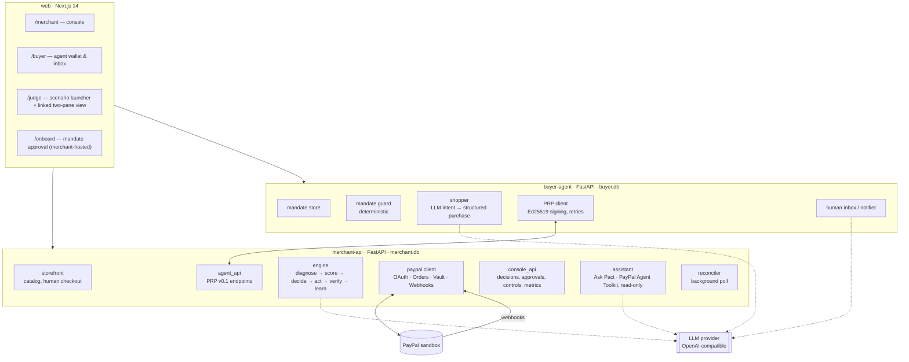

# 02 · Architecture

## 1. Services

Three deployable services, so the demo is genuinely two parties: the buyer agent
and the merchant do not share a process, a database or a secret.



## 2. Tech stack

| Layer | Choice | Why |
|---|---|---|
| Backend | Python 3.11, FastAPI, Pydantic v2, httpx | Fast to build and test; PayPal Agent Toolkit has a Python package (needs ≥ 3.11) |
| ML | scikit-learn (calibrated GBM), numpy, pandas, joblib | Calibrated probabilities with little code; no GPU needed |
| Storage | SQLite per service, WAL mode, append-only audit table | Zero ops; judge mode reseeds on boot |
| Signing | Ed25519 via the `cryptography` package for PRP v0.1 | Each party holds its own private key, so neither can forge the other's messages; PayPal webhooks use PayPal's own verification API |
| LLM | OpenAI-compatible adapter (Groq / OpenRouter / any) | Provider-agnostic; templates when no key is set |
| PayPal AI | `paypal-agent-toolkit` (Python) | Read-only tools for the merchant assistant |
| Frontend | Next.js 14 (App Router), Tailwind, **AG Grid Community** | AG Grid powers the decision ledger and audit trail (sponsor prize) |
| Tests | pytest, hypothesis (property tests), respx (HTTP mocking) | Invariants proved, not sampled |
| Deploy | Render: 2 web services (Python) + 1 web service (Next.js) | Hosted demo URL; Render handles TLS for webhooks |
| Local tunnel | cloudflared or ngrok | PayPal webhooks to localhost during development |

## 3. Repository layout

```
pact/
├── README.md · LICENSE · .env.example
├── docs/                         # this blueprint
├── schemas/                      # JSON Schemas — single source of truth for PRP
├── shared/                       # installed into both services
│   ├── prp/models.py             # Pydantic models generated from schemas/
│   ├── prp/signing.py            # canonical JSON + Ed25519 sign/verify + replay guard
│   ├── prp/keys.py               # keypair generation, public-key fingerprints
│   └── money.py                  # integer minor units ⇄ PayPal "12.34" strings
├── merchant/
│   ├── app.py                    # FastAPI wiring
│   ├── config.py
│   ├── db.py                     # schema, append-only audit writer
│   ├── paypal/
│   │   ├── auth.py               # OAuth2 client-credentials, token cache
│   │   ├── orders.py             # create / get / capture, PayPal-Request-Id
│   │   ├── vault.py              # setup tokens, payment tokens
│   │   ├── webhooks.py           # receive + verify-webhook-signature
│   │   └── subscriptions.py      # P2: outstanding-balance capture
│   ├── engine/
│   │   ├── taxonomy.py           # PayPal processor codes & order issues → classes
│   │   ├── diagnosis.py          # rules first, LLM fallback with confidence floor
│   │   ├── economics.py          # actions, costs, net expected value
│   │   ├── policy.py             # hard constraints → eligibility → economics
│   │   ├── holdout.py            # deterministic live holdout + lift
│   │   ├── controls.py           # kill switch, review-first mode
│   │   ├── executor.py           # turns decisions into PayPal calls / offers / links
│   │   ├── verification.py       # webhook + poll → outcomes
│   │   ├── learning.py · bandit.py · evaluate.py
│   │   └── provenance.py         # simulated events never reach PayPal
│   ├── ml/                       # features, train, predict
│   ├── simulator/                # generator + outcome oracle (PayPal codes, USD)
│   ├── agent_api/routes.py       # PRP endpoints
│   ├── storefront/               # catalog, human checkout, onboarding page API
│   ├── console_api/              # decisions, approvals, metrics, controls
│   ├── assistant/ask_pact.py  # LLM + Agent Toolkit (read-only) + Pact read tools
│   └── reconciler.py
├── buyer_agent/
│   ├── app.py · config.py · db.py
│   ├── mandate.py                # mandate model, budget ledger
│   ├── guard.py                  # THE decision function for offers
│   ├── shopper.py                # LLM: request → structured purchase intent
│   ├── prp_client.py             # signed calls to the merchant
│   └── notify.py                 # human inbox, LLM summaries
├── web/                          # Next.js app
├── scripts/
│   ├── spike/                    # feasibility spike scripts (doc 09)
│   ├── seed.py                   # judge-mode scenarios
│   └── verify_live.py            # PASS / FAIL / SKIPPED receipt per PayPal integration
└── tests/
    ├── merchant/ · buyer/ · shared/
    ├── properties/               # hypothesis invariants (doc 08)
    └── e2e/                      # both services + mocked PayPal; one sandbox smoke test
```

## 4. Reuse map

The decision core carries over. Everything that touched the previous payment
processor is rewritten against PayPal.

| Module | Fate | Change |
|---|---|---|
| `policy.py` | **Adapt** | Keep the three ordered stages; add channel-aware eligibility (agent vs human) and new hard constraints |
| `economics.py` | **Adapt** | Integer cents + currency; new actions (`ALTERNATE_FUNDING_OFFER`, `PAYER_ACTION_OFFER`, `CHECKOUT_LINK`) |
| `controls.py` | Keep | Kill switch and review-first mode as-is |
| `ml/` | Keep, retrain | New features: channel, alternate-funding count, PayPal decline class |
| `bandit.py`, `learning.py`, `evaluate.py` | Keep | `evaluate.py` gains live-holdout reporting |
| `provenance.py` | Keep | Same rule: simulated events never call PayPal or the LLM |
| `diagnosis.py` | Adapt | LLM fallback reads PayPal error `details[].description` instead |
| `integrations/llm.py` | Adapt | Multilingual copy instead of a single locale; keep the dark-pattern scanner |
| `taxonomy.py` | **Rewrite** | PayPal processor response codes and Orders v2 issues |
| previous processor client | **Delete** | Replaced by `merchant/paypal/` |
| `verification.py` | Rewrite | PayPal webhook events + order polling |
| `verify_live.py` | Rewrite | Exercises OAuth, orders, vault, webhook verification |
| `simulator/` | Adapt | PayPal codes, USD, agent vs human channel |
| `db.py` | Adapt | New tables (doc 07) |
| frontend | Rebuild | Two personas + judge mode; AG Grid ledger; keep the decision-inspector concept |
| guardrail tests | Port | Re-pointed at the new taxonomy |

### Port status (v0.3, 2026-11-12)


| Done — in `merchant/`, tests green | Waiting on the spike / new DB |
|---|---|
| `engine/taxonomy.py` (rewritten for PayPal), `economics.py`, `policy.py`, `controls.py`, `provenance.py`, `diagnosis.py`, `evaluate.py`; `engine/holdout.py` (new); `integrations/llm.py`; `ml/`; `simulator/`; `shared/money.py` | `paypal/` client, `executor.py`, `verification.py`, `reconciler.py`, `verify_live.py` (need spike fixtures); `db.py` (doc 07 schema); `bandit.py`, `learning.py` (read the DB); pipeline and `app.py`; frontend |

Fixes made while porting (each covered by a test):

- Evaluation let a contact-capped customer fall through to `ESCALATE`, i.e. ops
  contacting the customer anyway. Escalation is now blocked alongside contact,
  except for merchant-config and risk reviews.
- Same-instrument exclusion now covers **every** alias that declined on the
  intent, not only the latest (S3's second offer can't re-list the first card).
- The training diagnostic divided every prediction by one class's effectiveness;
  it now uses each event's own class, as inference does.
- Controls start in `review_first` (doc 05 §7) instead of `autonomous`.

## 5. Configuration

All configuration through environment variables (see `.env.example`). Each
integration reports its mode on `/health`: `live`, `fixture`, or `disabled`.
Missing PayPal credentials → fixture mode so a clean clone still runs and passes
tests offline.

## 6. Deployment (Render)

| Service | Type | Start command | Notes |
|---|---|---|---|
| `pact-merchant` | Web service (Python) | `uvicorn merchant.app:app --host 0.0.0.0 --port $PORT` | Public URL registered as the PayPal webhook target |
| `pact-buyer` | Web service (Python) | `uvicorn buyer_agent.app:app --host 0.0.0.0 --port $PORT` | Holds its own Ed25519 private key |
| `pact-web` | Web service (Node) | `npm run start` | `NEXT_PUBLIC_MERCHANT_URL`, `NEXT_PUBLIC_BUYER_URL` |

Free-tier services sleep when idle; judge mode shows a "waking services…" state
and the testing instructions say so. SQLite is reseeded on boot, so a judge
always starts from the same scenarios.

## 7. Cross-cutting rules

- Money is integer minor units everywhere; conversion to PayPal's decimal strings
  happens only in `shared/money.py`.
- Every PayPal write carries a deterministic `PayPal-Request-Id`.
- Every new PayPal attempt passes the consent check (`HARD_CONSENT_INVALID`,
  doc 05) immediately before the call — not only when the decision was made.
- The two services never share a key: each publishes a public key and keeps its
  private key in its own environment.
- Every engine stage writes one append-only audit row with inputs, outputs and
  rejected alternatives.
- No module outside `merchant/paypal/` imports httpx for PayPal; no module outside
  `executor.py` calls `merchant/paypal/` write functions.
- The buyer agent's only path to spending money is `guard.py → prp_client.py`.
