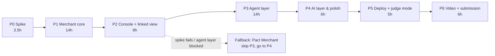

# 10 · Build plan

Ordered so that the merchant core — shared by the agent version and the Pact
2.0 fallback — is built first. The agent layer sits on top. If anything in the
agent layer fails, stop after Phase 2 and finish with the fallback scope.

Two plans below: the **full plan** (~57 focused hours) and a **deadline mode**
(~24 hours) for when the clock is the constraint. Effort is for one developer;
treat it as relative sizing.

## Full plan

### P0 · Spike (doc 09)

- [ ] Sandbox app, accounts, negative testing, webhook
- [ ] Scripts S1–S8 including **S4b** (consent & stored-credential encoding), `RESULTS.md`
- [ ] Go / no-go and the chosen stored-credential encoding recorded at the top of `RESULTS.md`

**Done when:** a decision is written down.

### P1 · Merchant core (shared with fallback)

- [ ] New repo, MIT `LICENSE`, `.env.example`, CI running pytest
- [ ] `shared/money.py` + tests
- [ ] `merchant/paypal/`: auth, orders (with the chosen `stored_credential` encoding), vault, webhooks (+ respx fixtures recorded from the spike)
- [ ] `engine/taxonomy.py`: PayPal codes → classes; full code list transcribed; coverage test
- [ ] Port `economics.py`, `policy.py`, `controls.py`, `provenance.py` with new actions and hard constraints, including **`HARD_CONSENT_INVALID` re-checked at call time**
- [ ] Decision output carries the **per-option table** data (p(a), p0, lift, cost, NEV, verdict, removing rule)
- [ ] `engine/holdout.py` + tests
- [ ] `simulator/` adapted (PayPal codes, USD, channel) → retrain `ml/`; metrics file
- [ ] `executor.py`, `verification.py`, `reconciler.py`
- [ ] Append-only audit; `db.py` schema (doc 07)
- [ ] Invariants I1–I3, I9–I16 green
- [ ] `scripts/verify_live.py` producing a PASS/FAIL/SKIPPED receipt

**Done when:** a scripted decline on a saved card produces a diagnosed failure and
a decision with a full stage trace and per-option table, from tests plus one live run.

### P2 · Console + linked view

- [ ] Console: live feed, **AG Grid** decision ledger, decision inspector with the per-option table, metrics with provenance split, holdout panel, controls, review queue
- [ ] `/judge/run/[intentId]` linked view shell (merchant pane now; buyer pane fills in P3)
- [ ] S4 runnable (human channel, DROP); S6 only if time allows

**Done when:** S4 runs against the sandbox and the inspector explains the refusal
without narration.

> **Fallback switch point.** If the spike said no-go, skip P3. Go to P4 with the
> fallback scope.

### P3 · Agent layer

- [ ] `schemas/` → `shared/prp/models.py` (+ a test that they agree)
- [ ] `shared/prp/keys.py` + `signing.py`: **Ed25519**, canonical JSON, method+path binding, nonce store, skew check
- [ ] Merchant `agent_api`: register (public-key exchange), checkout (402 + offer), offers get/accept/decline, intents
- [ ] Offer builder: options from the decision, rules R1–R4, scanner on `display.text`
- [ ] Onboarding: merchant-hosted page, vault setup tokens, mandate approval, registration
- [ ] `buyer_agent`: mandate store + budget ledger, **guard** with the visible checklist, PRP client, inbox, pause switch
- [ ] `shopper.py`: LLM → mandate draft / purchase intent, schema-validated
- [ ] Buyer view `/buyer`; buyer pane of the linked view
- [ ] Invariants I4–I8, I17, I18 green; red-team checklist (doc 08) passes
- [ ] S1, S2, S3 runnable; S5 as a short flash

**Done when:** S1 recovers a real sandbox payment with no human action and the
linked view shows both sides; S2/S3 escalate to Maya with a working PayPal link.

### P4 · AI layer & polish

- [ ] LLM explanations in the decision inspector and Maya's inbox (template fallback)
- [ ] Ask Pact: LLM + Pact read tools + PayPal Agent Toolkit (read-only)
- [ ] Copy pass; empty and loading states; accessibility basics

### P5 · Deploy + judge mode

- [ ] Render: three services, env vars (incl. both Ed25519 keys), webhook URL updated in PayPal
- [ ] `/judge` page: scenario cards, run, reset, "waking services…" state
- [ ] `seed.py` reseeds on boot
- [ ] Testing instructions with sandbox logins (doc 11)
- [ ] Fresh-clone test: README steps work offline (fixture mode) and live

### P6 · Video + submission

- [ ] Record S1–S4 (+ S5 flash) against the hosted demo, using the linked view
- [ ] Edit to < 3:00, captions on
- [ ] Devpost write-up, architecture image, screenshots
- [ ] Final compliance checklist (doc 11)

## Deadline mode (~24 h)

Use this if the submission deadline is about a day away. Same order, harder cuts.
Each block ends in something demoable, so stopping early still leaves a submission.

| Block | Hours | Build | Cut |
|---|---:|---|---|
| D0 Spike | 2.5 | Spike steps S1, S2, S4, S4b, S5/S5b, S6 only | Spike steps S7 webhooks (use polling) and S8 toolkit |
| D1 Merchant core | 7 | PayPal client, taxonomy (trigger codes only + `UNKNOWN`), ported policy/economics with consent check, per-option table data, polling verification | Holdout, full code list, bandit/learning, retraining (same model structure with a quickly regenerated simulator) |
| D2 Agent layer | 6 | Ed25519 signing, register/checkout/accept, offer builder, guard + checklist, mandate seeded (no LLM drafting) | Onboarding UI (seed the vault tokens via spike scripts), callbacks, pause switch |
| D3 UI | 4 | Linked view only: merchant pane (per-option table) + buyer pane (checklist) + timeline; scenario buttons | Full console, AG Grid ledger, review queue, Ask Pact |
| D4 Deploy | 1.5 | Render, judge reset | — |
| D5 Video + write-up | 3 | S1, S2, S4, S3 if it runs; S5 flash only if done | — |

**Deadline-mode gates:**
- After D1 (~10 h in): if the spike was no-go, switch to the fallback and spend D2's hours on the console instead.
- After D2 (~16 h in): if S1 doesn't recover end-to-end, demo S2 and S4 plus the guard as unit-tested logic, and say so plainly.
- AG Grid only if D3 finishes early — it's a sponsor prize, not the main story.

## Definition of done for the whole build

- All invariants green; red-team checklist passes.
- Every number on screen is labelled `sandbox`, `fixture` or `simulated`.
- A judge can run every core scenario from the hosted URL with no setup.
- `verify_live` receipt committed, generated honestly.
