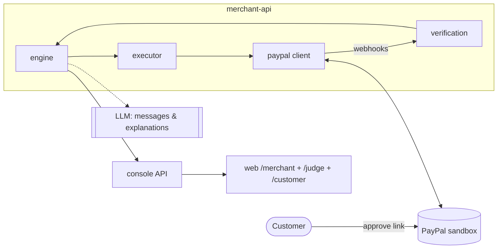

# Fallback · Pact Merchant — merchant-side recovery on PayPal

Use this scope if the feasibility spike (doc 09) shows an agent can't pay with a
saved PayPal source without a human, or if the agent layer (Phase 3) gets stuck.
It is the agent version **minus the buyer side**: every piece below is already
built in Phases 1–2 of the main plan, so switching costs nothing already done.

## 1. Pitch

> **Every payment has a strategy. Every action has a reason.**
> Pact is a merchant-side recovery agent for PayPal. It diagnoses each declined
> payment from PayPal's processor response, prices every possible intervention,
> acts only where the economics clear the merchant's floor — and measures, with a
> live holdout, the revenue it actually caused.

Differentiators to lead with (the novelty is lower than the agent version, so
the demo has to carry it):

1. **It visibly refuses** — when retrying is unsafe (PayPal says don't retry a
   suspected-fraud card) or when chasing costs more than it recovers.
2. **Incremental truth on live traffic** — the holdout reports caused revenue
   with intervals, not a gross number.
3. **Models predict, policies decide, LLMs explain** — the per-option table
   (chance with and without each action, lift, expected value) shows the model's
   contribution, and the decision inspector shows every rejected alternative.

Carried over from the main blueprint: the consent check before every PayPal call
(`HARD_CONSENT_INVALID`), the stored-credential encoding chosen in spike step
S4b (encoding B for merchant-initiated reorders), and the positioning rule —
product first.

## 2. Scope

| In | Out |
|---|---|
| PayPal client: OAuth, Orders v2, Vault v3, webhooks + verification | PRP protocol, offers, signing |
| PayPal decline taxonomy | Buyer agent, mandates, guard |
| Engine: diagnose → score → decide → holdout → act → verify → learn | Onboarding page for agents |
| Actions: `CHECKOUT_LINK`, `ESCALATE`, `DROP` (+ `SUBSCRIPTION_CAPTURE` if time allows) | Agent-channel scenarios S1, S2, S3, S5 |
| Merchant console with AG Grid ledger, decision inspector, holdout panel, review queue, kill switch | |
| Ask Pact (LLM + Agent Toolkit read-only) | |
| Judge mode, Render deploy, video | |

## 3. Architecture (subset of doc 02)

Two services instead of three: `merchant-api` and `web`.

## 4. Demo scenarios

| # | Name | PayPal decline | Decision | Shows |
|---|---|---|---|---|
| F1 | Worth saving | 5100 Generic decline, $48 reorder | Per-option table → `CHECKOUT_LINK` + clear message → customer pays → verified | End-to-end recovery through PayPal |
| F2 | Refuses to retry | 9500 Suspected fraud, $120 | No retry; `ESCALATE` to the review queue with evidence | Safety over conversion |
| F3 | Not worth chasing | 5400 Expired card, $4 add-on | `DROP` with the arithmetic | Economically rational refusal |
| F4 | Review-first | Any, merchant in review mode | Queued; merchant approves in the console → executes | Bounded autonomy |
| F5 | Measuring honestly | Batch over seeded + simulated traffic | Holdout lift with intervals; provenance split | Incremental, not gross |

The "act on one, refuse the other" pair (F1 vs F2/F3) is the centrepiece.

## 5. Build plan

Phases P0–P2 of [doc 10](../docs/10-build-plan.md), then:

- [ ] F4 review-first flow polished
- [ ] Subscription renewal recovery (`BILLING.SUBSCRIPTION.PAYMENT.FAILED` → `POST /v1/billing/subscriptions/{id}/capture`, `capture_type: OUTSTANDING_BALANCE`) — only if a sandbox subscription failure can be produced
- [ ] P4 (Ask Pact, explanations), P5 (deploy, judge mode), P6 (video, write-up)

## 6. Video outline (≈ 2:45)

1. 0:00–0:20 — "Failed payments are lost revenue. Retrying everything is how you
   annoy customers and trip fraud rules. Pact decides."
2. 0:20–1:00 — F1 end to end.
3. 1:00–1:40 — F2 and F3 back to back: two refusals, two different reasons.
4. 1:40–2:10 — F5 holdout panel: "what we caused" vs "what came back anyway".
5. 2:10–2:35 — Decision inspector + Ask Pact.
6. 2:35–2:45 — End card.

## 7. Prize targets

Grand prizes; Best Use of PayPal + AI; Most Impactful; one sponsor prize
(AG Grid). Agentic Commerce is not a realistic target in this scope — don't
claim it.

## 8. Switching checklist

- [ ] Write the decision and the reason at the top of `scripts/spike/RESULTS.md`
- [ ] Remove agent-channel scenarios from `/judge` and the seed script
- [ ] Hide `/buyer` and `/onboard` routes
- [ ] Swap README pitch for §1 above
- [ ] Use this file's video outline instead of doc 11 §1
